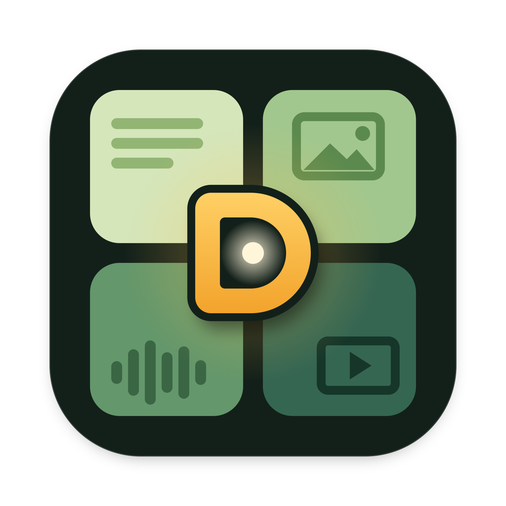
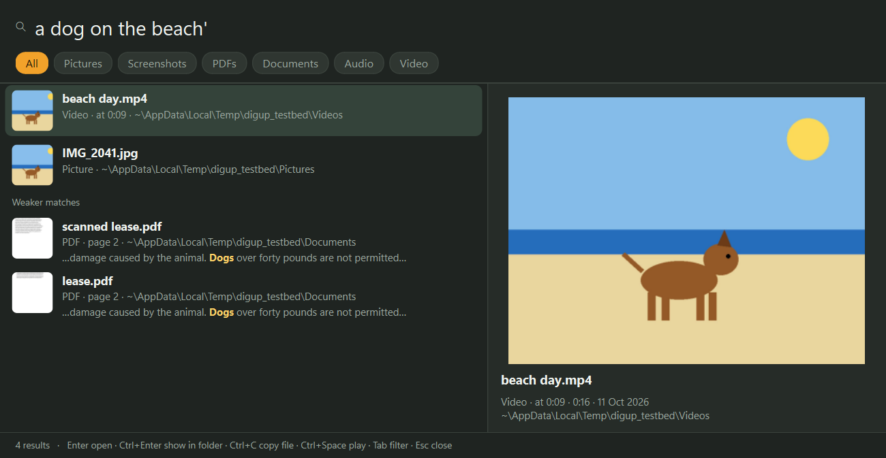
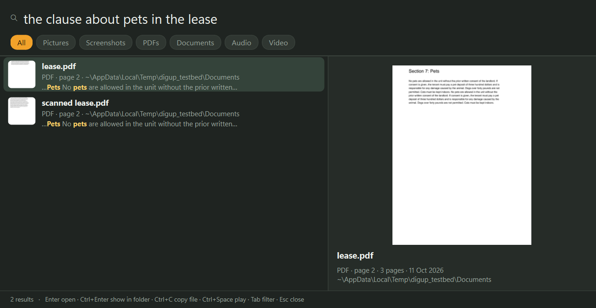
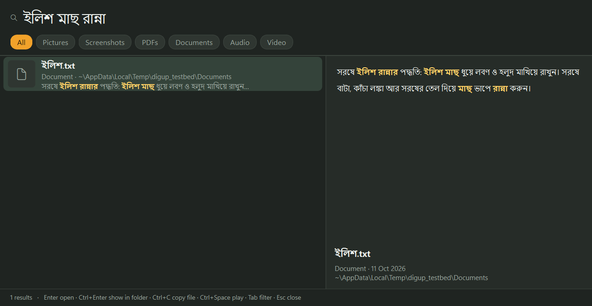

<p align="center"></p>

<h1 align="center">DigUp for Windows</h1>

<p align="center"><b>Describe it. Dig it up.</b><br>
Search the files on your PC by what's in them, with Google DeepMind's
<a href="https://huggingface.co/google/embeddinggemma-2">EmbeddingGemma 2</a>.</p>

<p align="center">A Windows port of <a href="https://github.com/ARahim3/DigUp">ARahim3/DigUp</a> (macOS) ·
Windows 10 and 11, x64 · NVIDIA (CUDA), any GPU with Vulkan, or the CPU · Free and open source</p>

<p align="center"></p>

EmbeddingGemma 2 puts text, images, audio and video into one shared space: a photo of a dog on a beach lands next to
the words "a dog on the beach", and a recording of someone talking about sleep lands next to "where they talk about
sleep". It understands more than 100 languages and is small enough (740M parameters) to run on a PC.

DigUp brings that to the files on your PC. Pick the folders to search, and it reads the pictures, PDFs, documents,
recordings and videos in them. Then press **Ctrl+Shift+Space** in any app, describe what you're looking for in your
own words, and it finds the match, whatever kind of file it is. All of it happens on your PC.

## What you can find

- "a dog on the beach" finds the photo, and the moment in a video where the dog shows up
- "where they talk about sleep" jumps to that minute of a podcast
- "the clause about pets in the lease" shows the PDF page, scanned or not, with the words marked
- "payment declined error" finds the screenshot, and so does the error code "K7Q2LM" (Windows OCR reads it)
- a search in English finds a note written in Bengali, Arabic or any of the model's 100+ languages, and the other way
  around
- "code: retry a failed call with backoff" finds the function in your projects, if you turn on code search

Exact words count too: invoice numbers, error codes and names are matched as written, in file names, document text and
the text inside screenshots, so a search gets both the meaning and the exact string.

<p align="center"> </p>

## Private

Nothing you index leaves your PC. DigUp goes online only to download llama.cpp and the model, once. No account, no
telemetry.

## Install

1. Build it (below), or download `DigUp-Setup.exe` from Releases once one is published (no admin rights needed).
2. Open DigUp. While it downloads the model (865 MB) and llama.cpp for your GPU (about 650 MB for CUDA, much less for
   Vulkan or the CPU), pick the folders to search. DigUp shows how long the first pass will take for each.
3. Press **Ctrl+Shift+Space** in any app and describe what you're looking for.

## Using it

| Key | What it does |
|---|---|
| Ctrl+Shift+Space | Opens the search panel from any app (change it in Settings) |
| ↓ ↑ | Moves through the results |
| Enter | Opens the result: videos and recordings at the moment, PDFs at the page, code in your editor at the line |
| Ctrl+Enter | Shows it in File Explorer |
| Ctrl+C | Copies the file, to paste anywhere |
| Ctrl+Space | Plays the video or recording in the preview, from the moment it matched |
| Tab | Narrows to pictures, screenshots, PDFs, documents, audio or video |
| Esc | Closes the panel |

DigUp lives in the notification area, where you can see how indexing is going, pause it, or open Settings.

To open a video **at the moment**, DigUp uses VLC, mpv, MPC-HC or PotPlayer if one is installed (Windows' own players
can't be told where to start); otherwise the video opens from the start. PDFs open at the page in SumatraPDF or
Microsoft Edge. Code opens at the line in VS Code, Cursor, Zed, Sublime Text, Notepad++ or a JetBrains IDE.

## What it reads

Only the folders you choose:

- pictures and screenshots (JPEG, PNG, HEIC, WebP, TIFF, RAW and more) by what they show, and screenshots by their text
  too. Screenshots are the files the Snipping Tool and Print Screen name ("Screenshot …"), and anything in a
  Screenshots folder
- PDFs, page by page, scans included: a page with little text is read as a picture and by OCR. A long PDF gets its
  first 30 pages right away and the rest once everything else is in (up to 5,000 pages a file)
- documents: txt, md, rtf, docx, odt, html. Text that's mostly numbers is matched by its exact text only
- audio of any length, in overlapping 30-second windows (the model listens to 30 seconds at a time), so a match
  points to its moment
- video of any length: a frame every few seconds, one per shot, plus the soundtrack the same way as audio

It never reads keys, certificates, password files, hidden or system folders, AppData, OneDrive files that are only
in the cloud (it would download them), or folders that look like datasets. Inside a code project (a folder with
`.git`, `package.json`, a `.sln` and the like) it reads only screenshots. You can skip more folders or file types in
Settings. DigUp only reads your files; it never changes, moves or uploads them.

## Code

Code search is off until you turn it on in Settings → Code, for the folders you pick. Then start a search with
`code:` and say what the code does, or type a name that's in it:

- "code: retry a failed call with backoff" finds the function, whatever it's called
- "code: refreshAccessToken" goes to the line that defines it, not the places that call it

It reads source files, notebooks (without their outputs) and a repo's own docs, and skips what git ignores, vendored
and generated code, and anything that looks like a key or a password.

## How it works

```
your folders ─► readers (Pillow, PDFium, ffmpeg, and Windows OCR for the text in screenshots and scans)
             ─► EmbeddingGemma 2 on llama.cpp (CUDA, Vulkan or CPU), in a worker process that quits when it's done
             ─► one SQLite file: a vector for every picture, page, passage, video frame and 30 s of sound,
                plus a keyword index (code search keeps a second one, for code)
your words   ─► the model's text part (~300 MB, only while you search) ─► nearest vectors + exact words
```

DigUp runs ggml-org's 8-bit build of EmbeddingGemma 2 through llama.cpp's own Windows release (b11461), loaded with
ctypes, so nothing needs compiling. Every vector lives in the same 768-dimensional space, which is why one query can
rank a video frame against a PDF page. Exact-word matches get a boost, because no embedding holds an invoice number
exactly. A test checks that the Windows pipeline makes the same vectors as the Mac app (cosine ≥ 0.999 on text in
three languages, a screenshot, a photo, a video frame and speech; measured ≥ 0.9997 on an RTX 4090). See
[DESIGN.md](DESIGN.md) for the details and what changed from the Mac app.

## Build from source

You'll need Python 3.12 and [uv](https://docs.astral.sh/uv/).

```powershell
git clone https://github.com/cgoat/DigUp-Windows; cd DigUp-Windows
uv venv --python 3.12 .venv; uv pip install --python .venv\Scripts\python.exe -e ".[dev]"
.venv\Scripts\digup download          # llama.cpp for your GPU and the model (once)
.venv\Scripts\python -m pytest -q     # the reference-vector test runs once the model is there
.venv\Scripts\python -m digup.app.main
```

`scripts\build.ps1` builds `dist\DigUp\` (`DigUp.exe` and `digup-cli.exe`) with PyInstaller, and an installer with
Inno Setup 6 when it's installed. There's also a command-line tool that indexes, searches and reports
(`digup --help`), and `scripts\make_testbed.py` builds a folder of test files to try it on.

## FAQ

**How is this different from Windows Search?** Windows Search finds files by their names, text and properties.
DigUp also finds them by what they show or say, and takes you to the page or moment. The two work fine side by side.

**Will it slow my PC down?** Only the first pass is heavy, and it runs below normal priority. After that it reads new
files only, a couple of seconds after they land. The model runs in a separate process that quits when there's nothing
to do. It can wait for a charger, and it pauses while battery saver is on.

**Does it need a GPU?** No, but it's much faster with one. On the CPU the first pass takes several times longer;
searching is quick either way.

## Thanks

To Abdur Rahim for [DigUp](https://github.com/ARahim3/DigUp), whose design, measurements and tests this port follows;
to Google DeepMind for EmbeddingGemma 2; and to ggml-org for llama.cpp and the GGUF conversion.

## License

MIT, as the original. See [LICENSE](LICENSE).
